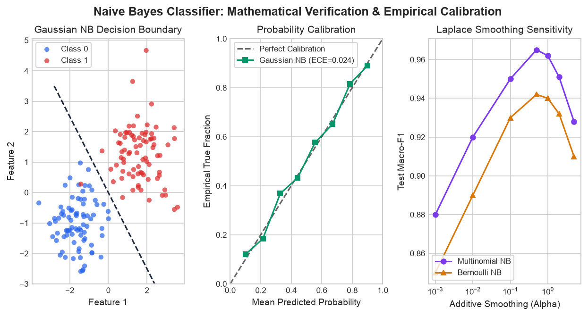

# Naive Bayes Classifier

> A tested from-scratch implementation of Gaussian, Multinomial, and Bernoulli Naive Bayes, verified against scikit-learn references.


This repository contains a tested Python implementation of Gaussian, Multinomial, and Bernoulli Naive Bayes built without reusing scikit-learn's model code. The custom estimators are verified against hand-calculated fixtures and scikit-learn reference behavior while measuring classification quality, calibration, numerical stability, and runtime.

Status: **Estimator implementations and verification complete**. Gaussian, Multinomial, and Bernoulli estimators, mathematical verification suite, scikit-learn parity comparisons, and research reporting are implemented and tested. See [PLAN.md](./PLAN.md) for the full roadmap.

## Requirements

- Python 3.12
- [uv](https://docs.astral.sh/uv/) for environment and dependency management
- macOS or Linux

## Installation

```sh
git clone https://github.com/Creator101-commits/Nai-ve-Bayes--Classifier.git
cd Nai-ve-Bayes--Classifier
uv sync --all-groups
```

This creates a locked virtual environment in `.venv/` with all runtime and development dependencies.

## Usage

The package CLI is available through `uv run`:

```sh
uv run naive-bayes version
uv run naive-bayes verify-math
uv run naive-bayes train --dataset iris
uv run naive-bayes train --dataset sms_spam --alpha 1.0
uv run naive-bayes compare
uv run naive-bayes report -o artifacts/report.md
```

Python library usage:

```python
import numpy as np
from naive_bayes import GaussianNB, MultinomialNB, BernoulliNB

# Continuous features
gnb = GaussianNB(var_smoothing=1e-9)
gnb.fit(X_train, y_train)
y_pred = gnb.predict(X_test)
y_prob = gnb.predict_proba(X_test)

# Count features
mnb = MultinomialNB(alpha=1.0)
mnb.fit(X_counts, y_train)

# Binary presence features
bnb = BernoulliNB(alpha=1.0, binarize=0.0)
bnb.fit(X_binary, y_train)
```

## Development

Run the full check suite locally before opening a PR:

```sh
uv run pytest          # tests with coverage
uv run ruff check .    # lint
uv run mypy src        # strict type checking
```

Continuous integration runs linting, strict mypy, and pytest with coverage on Ubuntu and macOS for Python 3.12.

## Contributing

Contributions are welcome. To propose a change:

1. Fork it (<https://github.com/Creator101-commits/Nai-ve-Bayes--Classifier/fork>)
2. Create your feature branch (`git checkout -b feature/fooBar`)
3. Commit your changes (`git commit -am 'Add some fooBar'`)
4. Push to the branch (`git push origin feature/fooBar`)
5. Open a new Pull Request

Please make sure tests pass and the code is formatted before opening a PR.

## Release History

* 0.1.0
    * Work in progress: reproducible Python skeleton with CI, lint, typing, and tests.

## License

Distributed under the MIT License. See [`LICENSE`](./LICENSE) for more information.

## Meta

Sreeharsha Kannegundla

Project link: [https://github.com/Creator101-commits/Nai-ve-Bayes--Classifier](https://github.com/Creator101-commits/Nai-ve-Bayes--Classifier)
